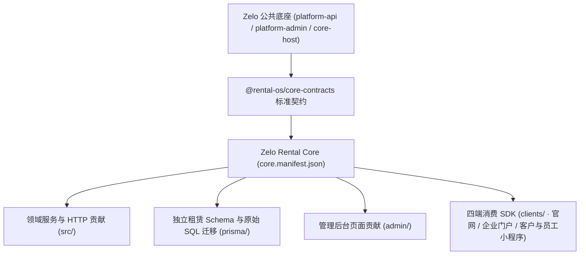

# Zelo Rental Core

**开源多租户 SaaS 底座 [Zelo](https://github.com/JinPen-G/Zelo) 的首个官方生产级业务 Core —— 覆盖多品类租赁全链路的独立业务包与架构参考实现。**

*The first official production business Core for [Zelo](https://github.com/JinPen-G/Zelo) — a full-featured, multi-category rental SaaS package and vertical Core reference implementation.*

[](LICENSE)
[](https://github.com/JinPen-G/Zelo-rental-core/releases/tag/v0.2.1)
[](https://github.com/JinPen-G/Zelo)
[](core.manifest.json)
[](package.json)
[](https://github.com/topics/zelo-core)

**简体中文** | [English](README.en.md)

---

**Zelo Rental Core**（`@rental-os/rental-core`）是运行在 **[Zelo](https://github.com/JinPen-G/Zelo)** 公共多租户 SaaS 底座之上的首个完整垂直业务 Core。它把租赁行业的全部核心业务——商品目录、资产与库存、多策略计价、报价与预约、订单配货与交接、归还验收与换货、资金与支付对账、个人/企业会员授信——封装为一个**完全独立的标准 Core 业务包**，不耦合底座本体，与底座各自独立升级。

> **快速导航**：[核心能力](#核心业务能力) · [架构与版本兼容](#架构与版本兼容) · [快速接入与安装](#快速接入与安装) · [使用与构建](#使用与构建) · [仓库结构与阅读路线](#仓库结构与阅读路线) · [HTTP API 文档](#http-api-文档) · [历史与业务收尾](#历史与业务收尾) · [共建 Core 生态](#以-rental-core-为参考共建行业-core-生态) · [许可证](#许可证与参与贡献)

---

## 核心业务能力

Rental Core 按租户与经营空间（`rental-workspace`）双层边界隔离业务数据，通过正式品类能力体系天然支持 **摄影器材、露营装备、车辆载具、工程设备** 等多品类租赁场景，并支持**无 AI 常规模式**与**选装受控 AI Native / MCP 模式**两种装配形态：

| 业务域 | 核心功能覆盖 | 入口导读 |
| --- | --- | --- |
| **商品目录与资产库存** | 型号/套装目录、单件序列号与数量型库存、资产状态历史、库存作业与处置恢复、图片托管 | [商品与资产前端](admin/catalog/README.md) · [库存事实仓储](src/mysql-core-facts.ts) |
| **定价、营销与服务容量** | 时间/用量/阶梯/封顶多策略计价、价格版本与冻结快照、优惠方案、优惠券、增值服务与营业日历 | [定价与营销前端](admin/commercial/README.md) · [计价策略](src/pricing.ts) |
| **报价、订单与履约交接** | 报价试算与不可变快照、订单确认与商户委托、资源配货与改配、交付/归还/续租/换货工作流、养护工单 | [订单前端](admin/orders/README.md) · [养护工单](admin/work-orders/README.md) |
| **会员体系与企业客户** | 租户共享客户主档、个人会员方案与激励、注册/资质审核、企业授信/月结回款、企业门户与行政交接审批 | [会员管理前端](admin/membership/README.md) · [企业门户 SDK](clients/enterprise-portal/README.md) |
| **财务结算与支付对账** | 订单账单、押金与预授权、员工线下收款登记/确认、第三方支付/退款回调、批量对账与差异核销 | [支付对账前端](admin/payment-reconciliation/README.md) · [支付运行](src/mysql-payment-runtime.ts) |
| **品类、规则与渠道治理** | 经营空间品类版本采用、空间能力治理、开业配置检查、履约地点管理、租户官网与微信小程序渠道配置 | [品类与规则治理](admin/governance/README.md) · [渠道配置](admin/channels/README.md) · [开业配置](admin/setup/README.md) |
| **经营工作台与多端 SDK** | 经营概览、报表分析与 CSV 导出；随包提供租户官网、企业客户门户、客户与员工微信小程序四端消费 SDK | [经营工作台](admin/operations/README.md) · [客户端目录](#阅读路线) |
| **可选 AI Native 与 MCP** | 不装 AI 即可完整运行全部业务；选装后复用 Zelo 统一 Model Gateway、审批链、原收据核对与受控 MCP | [AI 业务源](src/application-ai-sources.ts) · [AI 工作台前端](admin/assistant/README.md) |

---

## 架构与版本兼容

Rental Core 只维护租赁业务自身的领域模型、原始 SQL 迁移、HTTP 控制器、后台页面贡献与客户端 SDK；公共账号、多租户、组织权限树、订阅期限、加密凭据及管理后台外壳完全复用 **[Zelo 公共底座](https://github.com/JinPen-G/Zelo)**。



### 当前版本与兼容基线

| 项目 | 当前值 / 要求 | 说明 |
| --- | --- | --- |
| **Core ID / 版本** | `rental` · `0.2.1` | 标准包见 [v0.2.1 Release](https://github.com/JinPen-G/Zelo-rental-core/releases/tag/v0.2.1) |
| **兼容 Zelo 底座** | `>=0.2.0 <0.3.0` | 已与 [Zelo `0.2.2`](https://github.com/JinPen-G/Zelo/releases/tag/v0.2.2) 完成正式 API/Web 配对 |
| **接入契约版本** | `>=0.1.1 <0.2.0` | 沿 `@rental-os/core-contracts` 标准清单校验 |
| **运行环境** | Node.js `>=22.12.0 <25.0.0` · MySQL 8.4 | 与 Zelo 公共底座保持一致 |
| **数据版本与迁移** | `dataVersion: 0.1.1`（2 份原始 SQL 迁移） | 含初始租赁表与 `0.1.13` 换货工作流 6 表；详参 [数据升级说明](prisma/README.md#迁移与历史) |
| **在线发现标签** | `zelo-core` | Zelo 后台 `/platform/core-packages` 直接检索发现 |
| **许可证** | MIT License | [LICENSE](LICENSE) |

> **版本与更名说明**：
> - `0.1.14` 恢复独立后台订单报价总额原主题样式，相对 `0.1.13` 无新增数据库迁移；`0.1.13` 新增六张换货工作流表，已有部署升级前需先应用追加迁移（详见 [prisma/README.md](prisma/README.md#迁移与历史)）。
> - 本仓库已更名为 **`Zelo-rental-core`**，公开访问、克隆和问题反馈使用新地址。正式包和已安装部署锁保留 `https://github.com/JinPen-G/nativark-rental-core` 这一稳定来源身份。不要手改原锁；发现页因更名无法准备时，可将核过摘要的正式资产作为本地包准备。

---

## 当前开发源码与已发行版本

当前源码准备 Rental `0.2.2` 候选，兼容 Zelo `>=0.2.0 <0.4.0`，组合核验固定底座 `6d46f4943f7a0538f04e7ee2d908827d8345a666`。新装公共 AI 采用数据发行 `0.2.4` / SDK `0.2.5`；旧 `0.2.0`、`0.2.2` 数据发行继续按各自原前置读取。候选尚未发行；根发现清单、生成指南与下表仍对应已发行 `0.2.1`，schema、原 SQL、数据版本和历史 Tag 均保持原字节。当前合同只接受三段数字版本，候选资格由固定来源与构建记录区分，不能凭版本号作为服务器放行。

正式 `v0.2.1` 包来自固定独立源码 `bff93e81afbc9eb4d7e3b578cb26bb571393584f`，根发现清单与包内清单字节相同。旧 `v0.1.14`、`v0.1.15` 及后续已公开资产继续保留。原包按 Zelo `0.2.1` 构建，现已通过 [Zelo `0.2.2` 正式 API/Web 配对](https://github.com/JinPen-G/Zelo/actions/runs/46033089029)：选择 `public-retention`，MCP 关闭，核对同锁产物并完成镜像内冒烟。独立 CI 的普通/双 Core 构建、新装登录和重启证据见[固定运行](https://github.com/JinPen-G/Zelo-rental-core/actions/runs/46024876440)。现有混合库迁移、授权桥接与线上切换仍需单独批准，本回执不代表已更新服务器。

源码变化包括新报价配置组合的同事务核验、客户建单来源参加者、库存与资产写入前重读、冷实例配置与历史订单/工单读取、日历原键比较、渠道权限投影及官网目录结构门禁。原页面布局、样式、Token及业务迁移不随本次补齐改动。

### 本批接入变化

Core 停用后，受控宿主可通过 `originalReceiptRead` 登记已有操作、回答和模型结果的只读核对入口。登记须来自实际 Controller/handler 的封闭集合，仅限已审定的 POST 缓冲或审计读取；请求字段不能选择此模式。入口绑定原请求正文摘要，原读取器继续核对 Task/Run、原操作键、对象归属和当前权限，返回前复验成员分配、业务绑定及物理可用性。新任务、批准、输入提交和模型派发仍拒绝；缺省不登记时不开放停用后的读取。[请求准入](src/application-access.ts)

新报价的[配置组合依据](src/quote-configuration.ts)由报价服务捕获，在原事实事务内复核经营设置、商品与履约配置、价格计划、优惠、服务、日历、规则及不可变价格版本。[仓储组合](src/application-repositories.ts)通过 `mysql-business-facts` 正式出口的 `createRentalQuoteConfigurationReader` 复用同一配置仓储和调用方事务；自行装配事实仓储的宿主也须提供此读口。缺依据或读口时新报价不可保存，已有报价和原操作收据沿原历史事实读取，不重新采用当前配置。

原客户预约来源通过服务器侧 `RentalOrderCreationParticipant` 参加同一次建单事务，在首个 Tenant 锁前取得来源会话权威，并在写入后复核原材料与自然期限；HTTP 请求不能提供参加者或批准。见[建单端口](src/order-confirmation-ports.ts)和[订单确认](src/mysql-order-confirmation.ts)。

客户端渠道从有效空间身份投影权限；没有有效空间身份时只核租户原集成管理权，不将其他空间页面回退为租户权限。见[权限投影](src/permissions.ts)。

完整原接入说明保留在[领域修复固定版本的技术导读](https://github.com/JinPen-G/Zelo-rental-core/blob/8902e4d8db920cf33fd54992ec2cb939150985f0/README.md#阅读路线)，新首页与各模块 README 继续作为当前入口。

## 快速接入与安装

安装、部署注册、租户授权与成员分配在 Zelo 中各自独立办理，无需改动底座源码。完整原理见 [CORE_GUIDE.md](CORE_GUIDE.md) 及 Zelo 主仓的 [五步快速接入手册](https://github.com/JinPen-G/Zelo/blob/main/packages/core-contracts/README.md#五步快速接入)。

### 方式一：在 Zelo 管理后台在线发现安装

1. 启动兼容版本的 [Zelo 零 Core 底座](https://github.com/JinPen-G/Zelo#3-方式-a启动纯净零-core-公共底座推荐)，使用 SaaS 管理员账号登录。
2. 进入 **`/platform/core-packages`（Core 包管理）→「发现 Core」**，搜索 `rental` 或直接输入 `JinPen-G/Zelo-rental-core`。
3. 查看固定提交清单、兼容范围与 Release 资产 SHA-256 摘要，确认「准备候选」。发现页若提示仓库来源不一致，请下载同版标准包、核对摘要并使用本地包入口。
4. 按 [Rental 独立 API 宿主说明](workspace/apps/rental-api/README.md) 核对部署锁、适用迁移与启动条件。已有混合库须先完成原账桥接。
5. 由 SaaS 管理员在 `/platform/core-access` 为目标租户开通 `rental` Core 授权，再由租户管理员在 `/settings/member-cores` 为成员分配角色即可使用。

### 方式二：通过 CLI 核验固定发行

在 Zelo 源码根目录构建 `@rental-os/core-contracts` 后，可直接以只读方式核验指定版本发行并准备待部署候选：

```bash
npm run build -w @rental-os/core-contracts

# 1. 通过 zelo-core Topic 发现公开仓库
node packages/core-contracts/dist/github-release.js discover rental

# 2. 读取仓库固定清单与发行状态
node packages/core-contracts/dist/github-release.js repository JinPen-G/Zelo-rental-core --releases

# 3. 锁定指定版本 Release 元数据与 SHA-256 摘要
node packages/core-contracts/dist/github-release.js inspect JinPen-G/Zelo-rental-core rental <版本>
```

---

## 使用与构建

Rental Core 的源码开发与编译依托包含所选 Zelo 底座支持提交与本仓库的组合开发工作区。核心入口与工具链如下：

- **服务端装配**：通过 `@rental-os/rental-core/http` 的 `RentalHttpModule` 与 [完整应用工厂](src/application.ts) 接入独立宿主（详参 [Rental API 宿主导读](workspace/apps/rental-api/README.md)）。
- **管理后台装配**：前端宿主调用 [统一页面贡献](admin/index.tsx) 的 `createRentalAdminContribution(version, contexts)` 即可挂载全套租赁业务页面，自动复用 Zelo 外壳与权限上下文。
- **独立数据与迁移**：通过 [数据发行模块](src/data.ts) 与 [Prisma 数据接入](prisma/README.md) 组合独立模型与原始 SQL 迁移（支持无 AI `rental` 162 模型与含 AI `rental-ai` 248 模型两种组合）。

在已准备好的开发工作区根目录中，显式指向宿主生成的 Prisma Client 声明即可单独编译与检查本包：

```powershell
# PowerShell（Bash 下使用 export RENTAL_PRISMA_CLIENT=...）
$env:RENTAL_PRISMA_CLIENT = (Resolve-Path 'apps/rental-api/generated/client/index.d.ts').Path
npm run build -w @rental-os/rental-core
npm run lint -w @rental-os/rental-core
```

### 源码开发工作区

准备两份 Git 检出和底座已有的锁定 Node 依赖，选择包含双仓工具的底座提交与独立 Rental 提交。下面两个 SHA 都填写完整的 40 位提交值，输出使用尚不存在的 `.tgz` 路径。

```sh
node tools/prepare-workspace.cjs --framework-repo "<底座目录>" --repository https://github.com/JinPen-G/Nativark --framework-commit "<底座完整SHA>" --core-commit "<Rental完整SHA>" --profile domain --out "<新归档路径>"
```

开发快照可使用未打 Tag 的已提交源码。正式标准包继续通过底座的 `scripts/verify-rental-distribution.cjs --portable` 核对版本 Tag、发行来源、实际构建字节与归档摘要。旧 Tag 的根目录布局仍可读取，运行部署继续使用正式部署锁。

独立源码路径由 [rental.source.json](rental.source.json) 声明。`domain` 选择领域包，`host` 加入[普通业务 API](workspace/apps/rental-api/README.md)、[后台](workspace/apps/rental-admin)和 [Web 会话](workspace/packages/web-client/src/index.ts)，`full` 再加入[官网](workspace/apps/tenant-website)、[企业门户](workspace/apps/enterprise-portal)、[客户小程序](workspace/apps/miniprogram)和[员工小程序](workspace/apps/staff-miniprogram)。应用在组合工作区构建，原页面与设计规范保持。新装开发在带宿主的范围显式加 `--fresh-ai`，需要 23 条 MCP 数据计划时再加 `--mcp`；使用各自空库与原迁移账，旧库不能换锁直接采用。缺少真实 MCP 授权来源时不发布业务入口。声明缺件会中止，不从 Zelo 的旧业务目录补件。

归档内的 `development.workspace.json` 记录两仓提交、文件来源和摘要。组合从固定底座锁及[独立构建依赖锁](workspace.build-lock.json)核外部依赖；官网和企业门户仍使用各自锁定的 TypeScript，重叠固定依赖冲突直接拒绝。此文件供组合工具消费，解包后以生成的 `package-lock.json` 执行 `npm ci` 和 `npm run check:types`。构建不需要旧业务测试、私有资料、环境文件或作者生成物。

旧 Shared 与 AI 兼容源码由本仓的 `workspace/packages/{shared,ai-native-server,ai-native-admin,ai-native-data}` 承接。[来源清单](rental.source.json)的 `compatibility` 项记录原 Zelo 完整提交、目录和文件集摘要；准备工具逐项核对，缺件或字节变化即停止。Shared、原后台和所需数据读口随普通组合选择，旧服务端只随显式 AI 选择。这些固定快照保持旧出口与业务行为，不自动跟随底座的公共 SDK 更新。

显式公共保留组合仍从同次固定 Zelo 源编译公共服务端 `0.2.1`，仅供 `rental-ai-adapters` 解析；旧宿主继续解析本仓的 `0.1.0`。新装公共 AI 数据也从固定 Zelo 源生成，旧数据兼容包 `0.1.1` 保留原读口与历史迁移。更新兼容快照须同时核原调用者、来源摘要与依赖锁，不能改历史 SQL 或拿新 initial 替代旧账。新清单须搭配已支持 `compatibility` 角色的 Zelo 工具提交；旧工具会拒绝该角色。

在 `full` 组合中，四端分别使用 `npm run build:tenant-website`、`npm run build:enterprise-portal`、`npm run build:miniprogram` 和 `npm run build:staff-miniprogram`。官网和企业门户的开发入口为 `npm run dev:tenant-website`、`npm run dev:enterprise-portal`。各端仍须满足原构建前置和部署锁校验。

[独立开发 CI](.github/workflows/development-ci.yml) 使用工作流中固定的 Zelo 提交，编译本次 Rental 提交的普通 API、后台和四端。报告记录两仓来源、依赖锁和编译产物摘要，只用于开发验证；正式发行仍须按下节准备固定版本、部署锁和运行产物。

要在本地运行普通 API，使用含 `--development` 入口的固定 Zelo 工具生成[开发运行包](workspace/apps/rental-api/README.md#固定双仓普通开发运行包)。该包可在专用新 MySQL 上初始化并启动；它不适用于已有库升级，也不能进入正式部署。后台和四端由同一对固定提交准备。

#### 运行原 Core 回归

在准备命令中选择 `--profile full --with-tests`，并使用支持该选项的固定 Zelo 提交。此选项只接受开发模式，加入 [test](test) 中七份原材料、固定底座的离线守卫和工单示例；企业门户仍从本仓读取。默认开发组合与正式发行不携带测试。

[源码清单](rental.source.json) 的 `verification` 还登记了 [workspace/tests](workspace/tests) 和 [workspace/scripts](workspace/scripts)。显式开发组合将它们按固定独立提交的原字节投影到根 `tests/`、`scripts/`，每个文件的来源与摘要写入 `development.workspace.json`。材料不能覆盖底座构建脚本或离线守卫，也不会自动加入测试命令。

这些迁入材料包含业务回归、辅助 fixture 和历史运维脚本。运行单项前需核对它实际需要的 helper、宿主与数据库；迁入本身不表示所有入口已经适配完成。仍针对完整旧组合的入口以固定 Zelo `46db0945dee92ac916f7265e95948943fc8b641d` 保留，报价、资金、企业与批准等当前业务回归继续接独立宿主，不以历史版本代替当前验证。

解包后按[宿主构建说明](workspace/apps/rental-api/README.md)准备同版所选 Prisma Client，执行 `npm run build`，然后运行 `npm run test:rental`。该入口先执行四份编译产物用例，再串行运行两份 legacy 用例；也可分别运行 `test:rental:dist`、`test:rental:legacy`。原断言覆盖响应缓冲、页面出口、支付回调、撤权后的原结果及存量授权接管，使用明确的离线行存储，不连接数据库或供应商。

两份 legacy 用例共用 `output/.tmp/rental-lead-participants`，各自核对归属并在退出时清理，已有目录会拒绝覆盖。不要并行启动它们。准备命令只带入材料，不自动运行测试，也不安装依赖或迁移数据库；来源与用例清单记录在 `development.workspace.json.verification`。

#### Rental 与工单双 Core 示例

沿上述命令改用 `--profile multi-core`，并选择已支持此范围的固定 Zelo 提交。该工作区从本仓读取[双 Core API](workspace/apps/example-multi-core-api/README.md)和[双 Core 后台](workspace/apps/example-multi-core-admin/README.md)，从 Zelo 读取工单示例包。两端使用同一份含 Rental／工单的固定部署锁及对应标准包。这个范围只用于普通开发，旧双 Core AI 与原宿主测试使用下列固定历史版本。

#### 原宿主和四端测试

继续验证旧单仓断言时，单独检出[完整历史提交 `46db0945…`](https://github.com/JinPen-G/Zelo/tree/46db0945dee92ac916f7265e95948943fc8b641d)，用该检出的锁准备依赖，别把旧四端目录复制回 Zelo 主线。在旧检出根运行 `npm run test:tenant-website-resolve`、`npm run test:miniprogram` 或 `npm run test:staff-miniprogram`；两个小程序命令会先编各自的包。

其余[原端侧测试](https://github.com/JinPen-G/Zelo/tree/46db0945dee92ac916f7265e95948943fc8b641d/tests)也在同一检出执行：`enterprise-consumers` 及 AI 离线用例沿该版守卫与专用输出目录，读 `dist` 的用例先用该版 `build:legacy` 或所需小程序构建准备产物。原 `scripts/ai-native-b14-offline.cjs` 和 `scripts/generate-inspection-wire-schemas.cjs --check` 亦用该版复核。旧测试结果只证明旧组合；当前 Rental 的六份 Core 用例使用上面的显式开发验证组合，四端从 `full` 组合构建。

原宿主的 [16 份测试与案例](https://github.com/JinPen-G/Zelo/tree/46db0945dee92ac916f7265e95948943fc8b641d/apps/rental-api/test)在同一历史检出运行。包、双 Core 和恢复案例用 `node --no-compilation-cache tests/rental-host-package.test.cjs`；AI HTTP、知识、模型设置和任务案例由 `node --no-compilation-cache apps/rental-api/test/ai-composition.test.cjs` 统一调用。生命周期、文件清理与客户端请求等独立 `.test.cjs` 入口沿各文件说明；`openapi.test.cjs` 先准备该版 Rental API 编译产物。保留原断言和原测试用锁，不将历史结果用作当前双仓运行证据。

### 标准包发行

打包独立可分发的标准 Core `.tgz` 资产（含 `core.manifest.json`、编译入口、可移植 OpenAPI、`CORE_GUIDE.md`、`README.md`、`LICENSE` 与原始 SQL 迁移）及生成 `SHA256SUMS`：

```bash
# 1. 生成可移植标准 Core 发行包
node scripts/verify-rental-distribution.cjs --portable \
  --build-repo <Zelo底座Git目录> \
  --commit <构建SHA> \
  --platform-commit <底座SHA> \
  --source-repository https://github.com/JinPen-G/Nativark \
  --core-repo <Zelo-rental-core本地Git目录> \
  --core-commit <版本Tag对应的完整SHA> \
  --out <输出目录/rental-版本.tgz>

# 2. 按需打包独立 Linux Docker 宿主运行上下文（AI 可选 disabled / enabled）
node scripts/package-rental-host.cjs \
  --ai disabled \
  --deployment <原prepared部署目录> \
  --platform-package <固定底座.tgz绝对路径> \
  --rental-package <完整固定Rental包目录> \
  --client <apps/rental-api/generated/client/index.d.ts> \
  --platform-client <apps/platform-api/generated/client/index.d.ts> \
  --output <输出宿主归档.tgz绝对路径>
```

发布新版本时：在仓库创建对应 `v<版本>` Tag，将 `rental-<版本>.tgz` 与 `SHA256SUMS` 上传为正式 GitHub Release 资产，并同步更新根目录 `core.manifest.json` 与 `CORE_GUIDE.md`，确保仓库已打上 **`zelo-core`** Topic。

---

<a id="阅读路线"></a>
## 仓库结构与阅读路线

```text
Zelo-rental-core/
├── core.manifest.json          # 标准 Core 发现清单（ID、版本、兼容范围、权限、迁移与资产列表）
├── CORE_GUIDE.md               # 随包生成的底座五步接入与 Agent 协作指南
├── package.json                # @rental-os/rental-core 包声明与细粒度正式子出口
├── prisma/                     # 独立租赁 Prisma Schema 与原始 SQL 迁移链
├── src/                        # 领域服务、MySQL 仓储、HTTP Controller、OpenAPI 贡献与打包工厂
├── admin/                      # 管理后台页面贡献（商品、订单、定价、会员、工作台、对账、AI 助手等）
├── clients/                    # 面向租户官网、企业门户、客户与员工微信小程序的四端消费 SDK
└── test/                       # Core 合同、历史授权准备与接管等离线回归测试
```

### 模块导读入口

可选通用客户端适配见[客户与员工 contribution](clients/contribution/README.md)：普通客户本人订单取消、员工订单服务开始，复用原会话、当前权限和原操作收据；合同固定版本及宿主条件在该说明中维护。

| 模块分层 | 核心目录与说明入口 |
| --- | --- |
| **数据与迁移** | [Prisma Schema 与迁移升级说明](prisma/README.md) · [数据发行与迁移摘要](src/data.ts) |
| **应用与领域核心** | [完整应用组合](src/application.ts) · [HTTP 模块装配](src/http.module.ts) · [清单工厂](src/manifest.ts) · [标准包工厂](src/package.ts) |
| **管理后台页面** | [后台总览](admin/README.md) · [统一页面贡献](admin/index.tsx) · [浏览器会话与装配](admin/browser/README.md) · [商品与资产](admin/catalog/README.md) · [订单履约](admin/orders/README.md) · [定价营销](admin/commercial/README.md) · [会员与企业](admin/membership/README.md) · [经营工作台](admin/operations/README.md) · [品类与规则治理](admin/governance/README.md) · [养护工单](admin/work-orders/README.md) · [履约地点](admin/locations/README.md) · [能力治理](admin/capabilities/README.md) · [渠道配置](admin/channels/README.md) · [开业配置](admin/setup/README.md) · [支付对账](admin/payment-reconciliation/README.md) · [AI 助手](admin/assistant/README.md) · [任务中心](admin/task-center/README.md) · [桌面端授权](admin/agent-desktop/README.md) |
| **多端消费 SDK** | [租户官网数据 SDK](clients/website/README.md) · [完整租户官网 UI](clients/website-ui/README.md) · [企业客户 SDK](clients/enterprise/README.md) · [企业客户门户 UI](clients/enterprise-portal/README.md) · [客户小程序 SDK](clients/miniprogram/README.md) · [员工小程序 SDK](clients/staff/README.md) |

---

## HTTP API 文档

正式出口 `@rental-os/rental-core/http-openapi` 导出 `createRentalOpenApi()`，返回符合 Zelo `CoreOpenApiContribution` 规范的 `paths` 与 `schemas`（统一使用 `rental.` 命名空间，覆盖业务操作与 Schema），由宿主通过 `composeCoreOpenApi` 与公共底座文档组合并通过 `GET /api/openapi.json` 提供。

- **同源实现**：[HTTP OpenAPI 贡献](src/http-openapi.ts) · [操作定义](src/http-openapi-operations.ts) · [Schema 聚合](src/http-openapi-schemas.ts) · [规范可移植路径](src/http-portable.ts)
- **离线导出完整 OpenAPI JSON**：

```bash
node -e "const { createRentalOpenApi } = require('@rental-os/rental-core/http-openapi'); process.stdout.write(JSON.stringify(createRentalOpenApi(), null, 2))"
```

所有业务接口均复用 Zelo 公共身份鉴权与租户/空间范围守卫，写操作保留原事务边界、幂等键与原操作收据（`unknown` 结果仅核对原操作收据，绝不盲目重发）。

---

## 历史与业务收尾

- **原租户七分区设置**：`GET /api/platform/system-rules` 和 `PUT /api/platform/system-rules/:sectionKey` 由[原工作空间 Controller](src/http-workspaces.controller.ts)接入[兼容应用](src/application-system-rules.ts)。保留 `memberRegister`、`memberPoints`、`fleetMaintenance`、`fleetCleaning`、`calendarFixed`、`calendarSpecial`、`push` 的原分区替换规则，其中两个会员入口都替换整个会员分区。仍须当前租户的 `system:params:manage` 或原管理员授权、Rental 开通和成员分配；SaaS 管理员不可调用。保存沿原生效版本，在同一租户事务中合并并记录审计；其他分区和历史 AI 存储不变，响应屏蔽旧 AI 字段，不接受旧密钥写回。


Rental Core 为存量租赁租户切入 Zelo 标准 Core 授权体系、以及 Core 停用后的善后只读核对提供了严格的服务端接点：

- **存量授权只读对照与单项接管**：通过 [存量授权准备](src/legacy-access-preparation.ts)（`/legacy-access-preparation`）在只读快照中核对原租户、空间与角色映射，再经 [单项接管](src/legacy-access-adoption.ts)（`/legacy-access-adoption`）在原管理事务中逐项补齐租户授权、成员分配与范围绑定，保留原操作键收据与审计（回归用例见 [preparation 测试](test/legacy-access-preparation.test.cjs) · [adoption 测试](test/legacy-access-adoption.test.cjs)）。
- **停用后的受控原收据读取**：当 Rental Core 停用阻止新业务写入时，受控宿主可按 [请求准入](src/application-access.ts)、[善后声明](src/application-recovery-policy.ts) 与 [当前权威](src/application-recovery-authority.ts) 仅开放封闭集合内的历史订单、资金凭证、文件证据与原操作回执核对，确保在途业务与历史审计完整可追溯。

---

## 以 Rental Core 为参考，共建行业 Core 生态

Rental Core 是 Zelo 生态中的**第一个官方样板**，证明了复杂垂直行业系统完全可以作为独立 Core 插件优雅地构建在 Zelo 公共多租户底座之上。

**我们非常欢迎各行业的开发者、独立团队与软件服务商加入 Zelo 生态**，以 `Zelo-rental-core`（复杂业务参考）和 [Example Tickets Core](https://github.com/JinPen-G/Zelo/tree/main/packages/example-tickets-core)（轻量最小参考）为蓝本，打造更多垂直行业 Core 业务包（如 CRM、ERP、WMS、TMS、预约、教培、医疗、设备运维、门店连锁等）：

- **一键进入生态发现**：将你的公开业务 Core 仓库添加 GitHub Topic **`zelo-core`** 并发布标准 `.tgz` Release，即可被全球所有 Zelo 底座后台直接检索发现。
- **MIT 友好，支持商业化扩展**：Zelo 公共底座与本仓库均采用宽松的 **MIT License**。你可以基于 Zelo 开源基础版行业 Core 积累社区，同时**自由售卖自有业务包的高级扩展功能、行业插件、多端客户端、外部系统连接器或企业级私有化交付服务**，拥有完全自主的许可与定价权。

---

## 许可证与参与贡献

- **开源协议**：本项目自有源码与文档采用 **[MIT License](LICENSE)** 开源，允许自由使用、修改、分发和商业使用（保留原版权与许可声明即可）。第三方前端参考归档与组件保留各自原始许可文件。
- **参与贡献**：欢迎提交 Issue 与 Pull Request 改进 Rental Core，或前往主仓库 **[JinPen-G/Zelo](https://github.com/JinPen-G/Zelo)** 参与公共底座建设与交流；提交新业务 Core 时可结合 [CORE_GUIDE.md](CORE_GUIDE.md) 中的开发与 AI Agent 协作模板快速起步。
- **相关仓库**：[Zelo 公共底座](https://github.com/JinPen-G/Zelo) · [Zelo 平台官网](https://github.com/JinPen-G/Zelo-website)
